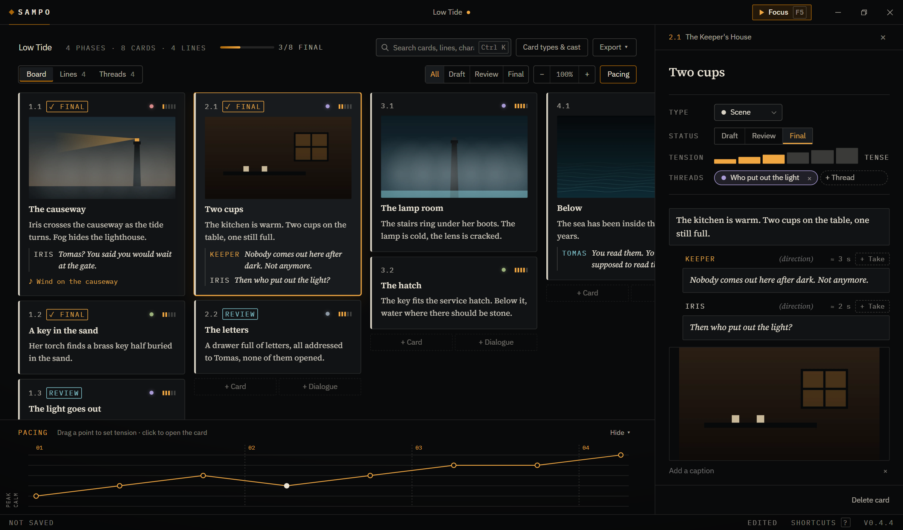
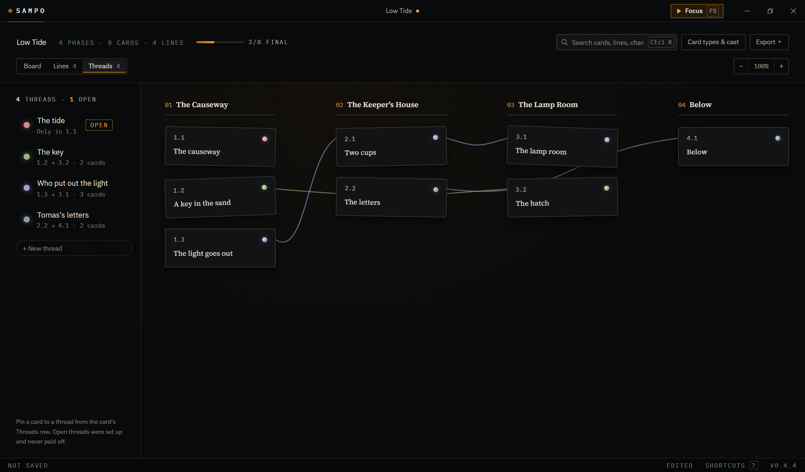
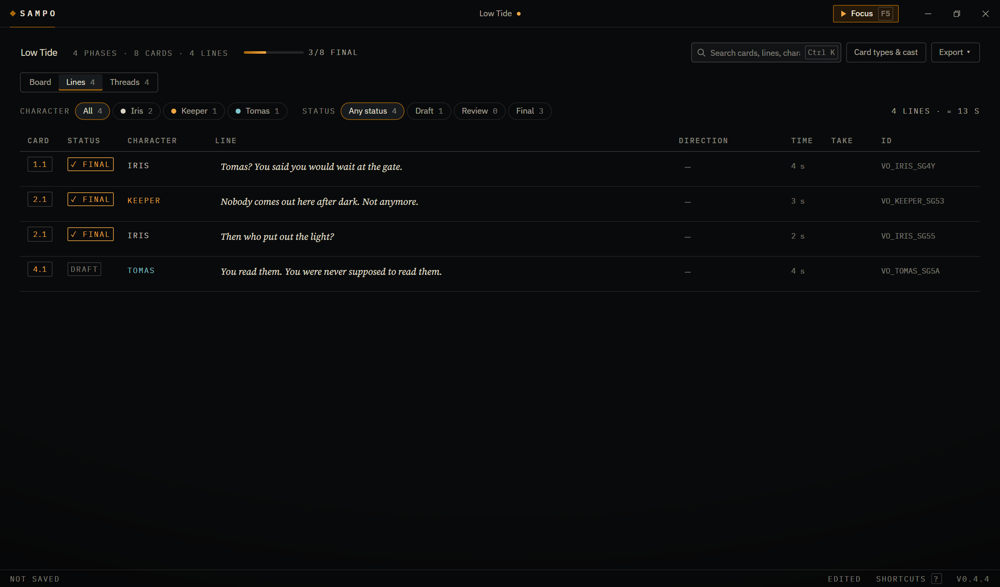
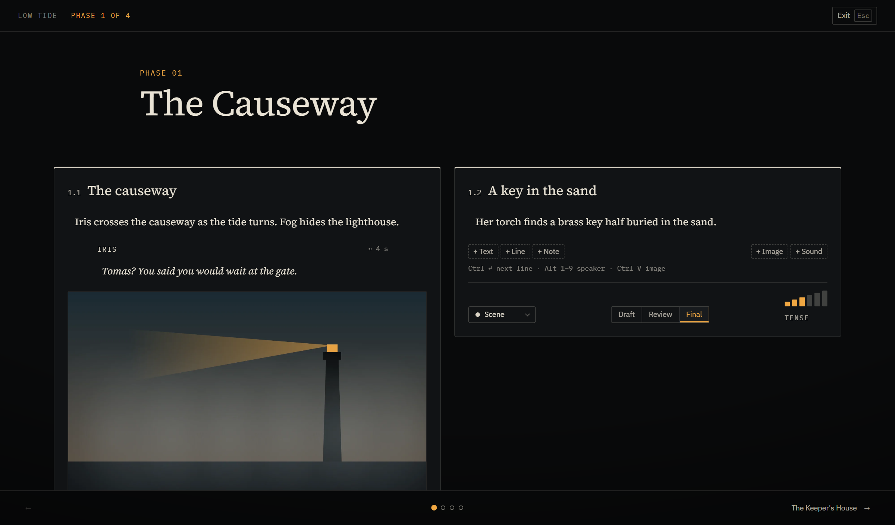

<h1 align="center">SAMPO Studio</h1>

<p align="center">
  <strong>A story and dialogue board for game teams.</strong><br />
  Plan the story, write the lines, follow every thread, and hand the studio a script that is ready to record.
</p>

<p align="center">
  
</p>

---

## What it is

SAMPO Studio is a desktop tool for writing the story of a game. A story is laid out as
**phases** (an act, a chapter, a level) made of **cards** (a moment, a scene, a conversation).
Each card holds what happens, who says what, how it should be delivered, and the pictures and
sounds that set its mood.

It is built for linear, authored stories: the kind told through levels, cutscenes and voiced
dialogue, where the hard problems are pacing, consistency and getting thousands of lines
recorded correctly. Branching node graphs are deliberately left out; the board reads like the
story it tells.

Everything stays on your machine. A story is a single `.sampo` file you can back up, send to a
colleague or carry to a recording studio, with every picture and sound packed inside it.

## The board

The board is where the story is shaped. Phases run left to right and cards stack beneath them.

- **Paste a script to start.** Paste a document from any editor and SAMPO drafts the structure:
  headings become phases, paragraphs become cards, and screenplay cues such as `IRIS: …` become
  lines with their speaker. Anything the rules miss is one click from right.
- **Cards say what they are at a glance:** their first picture as a storyboard frame, the
  opening of the scene, the first lines of dialogue, their status and their tension.
- **Drag cards** between phases, split a phase at any card, or merge it back.
- **Status per card:** Draft, Review and Final, with a progress bar for the whole story and a
  filter that fades everything else during a review pass.
- **Pacing:** tension is set per card and drawn as a curve under the board, so a slack middle
  or a climax that peaks too early is visible before anyone plays it.
- **The inspector** opens a card in full: type, status, tension, story threads, and its script
  of prose, dialogue, notes, pictures and sounds.

## Story threads

<p align="center">
  
</p>

Mysteries and horror live on what the audience is told early and paid off late. Threads make
those promises visible.

- **Pin a card to a thread** from its inspector: the key in the sand, who put out the light.
  Threads are created by naming them and disappear when the last card is unpinned.
- **The Threads view** is a detective's wall: only the cards that carry a thread, pinned up in
  story order and joined by a coloured string per thread. Where several strings meet on one
  card, the story ties together.
- **Open threads** are flagged. A thread set up on a single card and never paid off is marked
  open in the list, the dangling clue every writer wants to find before a player does.
- **Point at a card** to light up every thread that runs through it and see them by name;
  choose a thread in the list to follow it alone.

## Dialogue and voice recording

<p align="center">
  
</p>

The Lines view lists every spoken line in story order, the way a recording team needs it.

- **Write dialogue fast.** `Ctrl Enter` adds the next line and alternates speakers,
  `Alt 1–9` picks a speaker, and a delivery note sits beside each line.
- **Filter by character and status** to see exactly what an actor has left to record.
- **Stable recording IDs** such as `VO_IRIS_SG4Y` survive edits and reordering, so recordings
  stay matched to their line.
- **Takes:** attach a scratch or final recording to any line and play it in place.
- **Casting:** give each character a voice actor.
- **Export** every line, or only the lines on final cards, as a spreadsheet for the studio with
  ID, character, line, direction, estimated length, card, status, actor and take. The script
  also exports as Markdown for reading and printing.

## Presenting

<p align="center">
  
</p>

`F5` turns the story into a presentation, one phase at a time, full screen. It is built for
walking a team through the story. Everything stays editable, so notes from the meeting go
straight into the story, and pictures and sounds play where they are.

## Built to be trusted

A story tool holds months of work. SAMPO treats that seriously.

- **Atomic saves.** Every save is written to a temporary file, flushed to disk and renamed into
  place, so a crash or power cut can never leave a half-written story. The previous version is
  kept beside it as a backup.
- **Autosave** a moment after each change, and never two saves at once.
- **Changes on disk are noticed.** If another program or a synced copy saved the file since it
  was opened, SAMPO stops and asks rather than overwriting someone else's work.
- **One self-contained file.** Pictures are scaled and compressed when added; pictures and
  sounds are stored inside the `.sampo` package under the hash of their content, so a story
  opened on another computer has everything it needs.
- **Validated on load.** A damaged or hand-edited file is checked field by field and explained,
  never silently accepted. Older files are upgraded through versioned migrations.
- **Automatic updates,** signed and verified before they install.

## Keyboard

| Action                          | Keys               |
| ------------------------------- | ------------------ |
| Search the story                | `Ctrl K`           |
| Present                         | `F5`               |
| Full screen                     | `F11`              |
| Move between cards              | Arrow keys         |
| Move the selected card          | `Alt` + Arrow keys |
| Step a card's status            | `S`                |
| Next line, alternating speakers | `Ctrl Enter`       |
| Zoom around the pointer         | `Alt` + Scroll     |
| Scroll sideways                 | `Ctrl` + Scroll    |
| All shortcuts                   | `?` or `F1`        |

## Under the hood

| Layer             | Technology                             |
| ----------------- | -------------------------------------- |
| Application shell | Tauri 2, Rust                          |
| Interface         | React 19, TypeScript in strict mode    |
| Build and tests   | Vite, Vitest, ESLint, Prettier, Clippy |
| Platform          | Windows; installers as NSIS and MSI    |

The code is organised in three layers, each depending only on the one beneath it:

- **`src/core`** holds the story model, the file format, import, export and search as pure,
  immutable functions, with no knowledge of React or Tauri. Undo is a matter of keeping the
  previous value.
- **`src/app`** holds the commands, document state, autosave and the bridge to the desktop.
- **`src/ui`** holds the React interface.

The desktop side in `src-tauri` is deliberately small: reading and writing story packages,
storing media and writing exports, each covered by its own tests.

## Development

Requirements: Node.js LTS, pnpm, Rust stable and the Visual Studio C++ build tools.

```powershell
pnpm install          # install dependencies
pnpm tauri dev        # run the desktop app with live reload
pnpm check            # typecheck, lint, format check and tests
pnpm release 0.5.0    # check, bump the version, commit and tag a release
```

Pushing a version tag builds and signs the Windows installers on GitHub Actions and publishes
the update that installed copies pick up on their next start.

## Copyright

Copyright © 2026 Otto Saarimaa. All rights reserved.

This repository is visible for reference only. No licence is granted to use, copy, modify or
distribute the code or the application without written permission.
